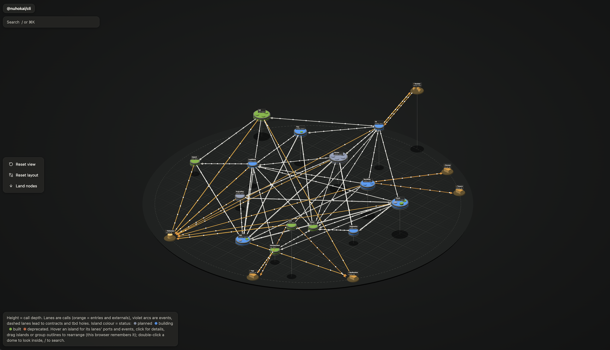

# nuhokai

**Architecture as code, type-checked. Built for repos where agents write most of the code.**

nuhokai is a TypeScript format and a CLI. You declare your system's components, their interfaces and their
dependencies in a `nuhokai/` folder; `tsc` and `nuhokai check` keep it consistent, and your coding agent builds and
reviews code against it.



_nuhokai's own CLI, [described in nuhokai](packages/cli/nuhokai) and drawn by `nuhokai map`._

## The problem

Agents produce code faster than you can review it. They work file by file with no view of the design, so module
boundaries erode and dependencies creep in that nobody decided on. Diagrams and docs don't help: a tool can't check
them, and an agent doesn't read them.

## See it

A component is a `node`: its purpose, the code it covers, the ports it offers and the ports it uses.

```ts
// nuhokai/shop.ts
import { node } from "@nuhokai/world";

export const Stock = node({
  id: "01a16dd2-bc2d-708e-89cb-3a9da2e0550d",
  purpose: "Counts what is on the shelf and holds reservations.",
  source: ["src/stock/**"],
  ports: { reserve: { kind: "call", purpose: "Reserve items for an order" } },
}).edges({});

export const Orders = node({
  id: "01a16dd2-bc20-732c-ae7b-02362b8baff1",
  purpose: "Owns orders from checkout to delivery; does not know how stock is counted.",
  source: ["src/orders/**"],
  ports: { place: { kind: "call", purpose: "Place an order" } },
}).edges({
  uses: () => [Stock.reserve],
});
```

```ts
// nuhokai/index.ts: the entry point, listing the top-level nodes
import { defineWorld } from "@nuhokai/world";
import { Orders, Stock } from "./shop.ts";

export default defineWorld({
  id: "01a17bb6-ad4d-7298-8492-a53237d45f80",
  name: "Shop",
  source: ["src/**"],
  children: [Orders, Stock],
});
```

Now depend on a port that doesn't exist, say `Stock.reserv`. Your editor underlines it, and `nuhokai check` tells
you or your agent where it is and what to do:

```text
error: nuhokai/shop.ts:12: Orders.uses lists a value that is not a port reference; list other nodes' ports, e.g. uses: () => [A.run]
error: nuhokai/shop.ts:19: Property 'reserv' does not exist on type 'NodeHandle'. Did you mean 'reserve'?
failed: 2 errors, 0 warnings
```

## What you get

- **Dependencies are typed references.** `uses: () => [Stock.reserve]` is real TypeScript: completion,
  go-to-definition and find-references work on your architecture, and a dangling reference is a `tsc` error.
- **Rules you can enforce.** `nuhokai check` exits 1 on violations such as an out-of-scope dependency, a duplicate id
  or a `source` glob matching no files. Each finding is one `file:line` line, easy to grep and easy for an agent to fix.
- **A spec per component.** Purpose, ports, requirements and design decisions sit next to the code. `nuhokai review`
  has your agent check a component's code against them.
- **A map of the real thing.** `nuhokai map` writes a self-contained HTML file: a searchable 3D graph of components,
  dependencies, what has code yet and the parts not designed yet.
- **No toolchain.** One binary with its own type checker. No `node_modules`, no build step; the files are read
  statically and never executed.

## Try it

It takes a minute and adds one folder, `nuhokai/`, to your repo. Your code and your dependencies stay untouched;
delete the folder to undo it.

[Install](#install) the binary, then in any repo:

```sh
nuhokai init     # scaffold nuhokai/ with an example node, a tsconfig and the format's types
nuhokai check    # type-check and run the rules; exit 1 on errors, so it fits CI and agent loops
nuhokai map      # write nuhokai/.generated/map.html, then open it in a browser
```

Replace the example with two or three of your real components, or ask your agent to. Then put it in the loop with
one line in your `AGENTS.md` or `CLAUDE.md`:

```text
The architecture is specified in nuhokai/. Run `nuhokai check` after every change to it and fix what it reports.
```

Go deeper: the [format](packages/world/README.md), the [CLI](packages/cli/README.md), or `nuhokai --help`.

## Install

macOS (Apple silicon) and Linux (x64, arm64):

```sh
curl -fsSL https://raw.githubusercontent.com/maxdollinger/nuhokai/main/install.sh | bash
```

It installs the latest release into `~/.nuhokai/bin`, after checking it against the release's checksums, and adds
that folder to your `PATH`. Open a new shell and run `nuhokai --help`. To uninstall, delete `~/.nuhokai` and its line
in your shell config.

Options go on `bash`, e.g. `curl … | NUHOKAI_VERSION=0.2.0 bash`: `NUHOKAI_VERSION` pins a version,
`NUHOKAI_INSTALL` picks another folder, and `NUHOKAI_NO_MODIFY_PATH=1` leaves your shell config alone. Prefer to read
it first? It's [install.sh](install.sh).

[Apache License 2.0](packages/cli/LICENSE)
