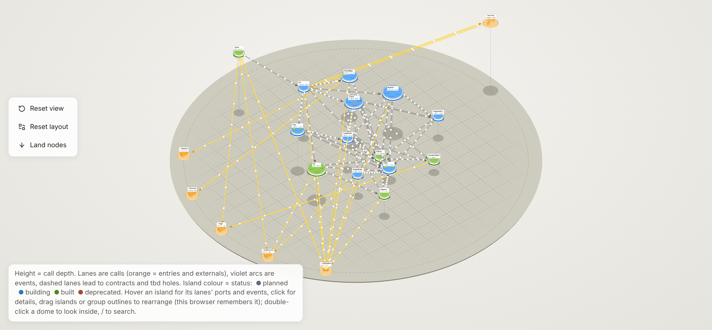

# nuhokai

Your architecture as typed TypeScript in the repo, checked like code and readable by people and coding agents.



## Why

A system's design usually lives in diagrams and docs that drift from the code, and coding agents never see it. nuhokai
keeps it next to the code as one checked source of truth: what each part is for, what it may use, and why.

That makes it a tool for agentic coding. An agent gets a spec to work from and something to check its code against,
and every command answers in seconds with lines it can act on, so the loop of plan, build and check stays fast.

## How

Each component is a **node** in a `nuhokai/` folder. Edges are typed references, so `tsc` catches a dangling one and
your editor navigates the graph. The files are read as data, never run. `tbd` marks what is not designed yet.

```ts
import { node, tbd } from "@nuhokai/world";

export const notify = tbd.call({ description: "Tell the customer; channel not decided." });

export const Stock = node({
  id: "01a16dd2-bc2d-708e-89cb-3a9da2e0550d",
  purpose: "Counts what is on the shelf and holds reservations.",
  status: "planned",
  source: ["src/stock/**"],
  ports: { reserve: { kind: "call", purpose: "Reserve items for an order" } },
}).edges({});

export const Orders = node({
  id: "01a16dd2-bc20-732c-ae7b-02362b8baff1",
  purpose: "Owns orders from checkout to delivery.",
  status: "planned",
  source: ["src/orders/**"],
  ports: { place: { kind: "call", purpose: "Place an order" } },
}).edges({
  uses: () => [Stock.reserve, notify], // `Stock.reserv` fails tsc
});
```

## The map

`nuhokai map` draws the world as a 3D map, like the one above of nuhokai's own CLI. Explore dependencies, search for
any node or port, and look inside a part by double-clicking it. Colors show each part's status, and `tbd` holes stand
out, so you see what is missing and where the architecture is tangled or thin.

## Usage

Get the binary from the [releases](https://github.com/maxdollinger/nuhokai/releases); nothing else to install.

```sh
nuhokai init     # create nuhokai/ with an example world
nuhokai check    # type-check the world and its rules
nuhokai tree     # one line per node
nuhokai map      # draw the 3D map
nuhokai review   # let your coding agent review a node's code against its spec
```

`nuhokai <command> --help` has the details. Format: [packages/world](packages/world/README.md), CLI:
[packages/cli](packages/cli/README.md).

## Development

```sh
bun install && bun test && bun run typecheck && bun run check
```
